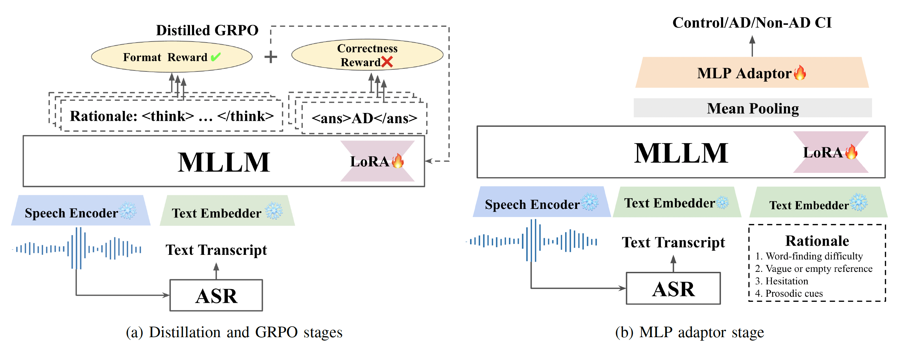

# Do Multimodal Large Language Models Need Reasoning to Classify Dementia from Speech?



We propose *Dementia Thinker with Nonlinear Adaptor and Reinforcement Learning (DeTAiL)*, an adaptor-based framework that exploits the internal representations of reasoning MLLMs for improved dementia classification. If you find this repo to be useful, please consider citing our [paper](https://arxiv.org/pdf/2607.00260)
~~~~~~~~
@inproceedings{wang2026detail,
  author    = {Liming Wang and Neguine Rezaii and Bradford C. Dickerson and James Glass},
  title     = {Do Multimodal Large Language Models Need Reasoning to Classify Dementia from Speech?},
  booktitle = {SLT 2026},
  year      = {2026},
}
~~~~~~~~


## Running Qwen MLP Experiments

The Qwen MLP adaptor experiments are launched with the SLURM scripts in
`scripts/`:

- `scripts/run_grpo_distil_reason_adress.slurm` to train ADReSS rationale SFT
  and GRPO-distilled checkpoints.
- `scripts/run_grpo_distil_reason_leads.slurm` to train LEADS rationale SFT
  and GRPO-distilled checkpoints.
- `scripts/run_qwen_mlp_adress.slurm` for ADReSS experiments.
- `scripts/run_qwen_mlp_leads.slurm` for LEADS cross-validation and transfer
  experiments.

The GRPO distillation scripts provide the LoRA checkpoints and generated
reasoning traces consumed by the Qwen MLP scripts. They request two GPUs on the
`a6` partition by default. The Qwen MLP scripts request one GPU on the `a5`
partition by default. All four scripts activate the `ms_swift` conda environment
and write SLURM logs to `scripts/logs/`.

### Submit Jobs

Run the scripts from the `scripts/` directory. The scripts begin with `cd ..`,
so submitting them from another directory can put the job in the wrong working
tree.

```bash
cd /data/sls/scratch/limingw/workplace/speaker_anonymization/DeTAiL/DeTAiL/scripts
mkdir -p logs

# ADReSS GRPO-distilled reasoning checkpoint job
sbatch run_grpo_distil_reason_adress.slurm

# LEADS GRPO-distilled reasoning checkpoint job
sbatch run_grpo_distil_reason_leads.slurm

# ADReSS Qwen MLP job
sbatch run_qwen_mlp_adress.slurm

# LEADS Qwen MLP job
sbatch run_qwen_mlp_leads.slurm
```

Monitor the jobs and logs with:

```bash
squeue -u "$USER"
tail -f logs/<job_id>_grpo_distil_reason_trace_adress.out
tail -f logs/<job_id>_grpo_distil_reason_trace_leads.out
tail -f logs/<job_id>_qwen_mlp_adress.out
tail -f logs/<job_id>_qwen_mlp_leads.out
```

### Checkpoint Preparation

Run the GRPO distillation scripts before Qwen MLP adaptor stages that load DeTAiL
checkpoints. These scripts use the same `stage` and `stop_stage` pattern as the
MLP scripts; edit those variables near the top of the script before submitting.
Some rationale-generation and SFT-data preparation commands are commented in the
scripts, so enable the corresponding blocks if regenerating every intermediate
file from scratch. If those JSONL files already exist, the checkpoint stages can
reuse them directly.

For ADReSS, the main checkpoint-generation flow is:

```bash
# In scripts/run_grpo_distil_reason_adress.slurm, run these stages in order.
stage=0;  stop_stage=0   # build rationale-generation prompts
stage=1;  stop_stage=1   # generate Gemini rationales, requires Gemini access
stage=10; stop_stage=10  # build student SFT and GRPO-distill JSONL files
stage=20; stop_stage=20  # train rationale SFT LoRA checkpoint
stage=40; stop_stage=40  # train GRPO-distilled DeTAiL LoRA checkpoint
stage=41; stop_stage=41  # run inference and create infer_result/ traces
```

The ADReSS GRPO-distilled checkpoint is written under:

```text
ms-swift/output/Qwen2.5-Omni-7B/adress/grpo_distill_2class_lora_rank_128
```

`run_qwen_mlp_adress.slurm` stages `60` and `61` load the latest checkpoint from
that directory. Stage `61` also reads self-generated reasoning traces from the
checkpoint's `infer_result/` directory, which is created by GRPO stage `41`.

For LEADS, the main checkpoint-generation flow is:

```bash
# In scripts/run_grpo_distil_reason_leads.slurm, run these stages in order.
stage=0;  stop_stage=0   # build rationale-generation prompts
stage=1;  stop_stage=2   # optionally generate Gemini rationales, requires Gemini access
stage=10; stop_stage=10  # build GRPO-distill JSONL files for all folds
stage=20; stop_stage=20  # train rationale SFT LoRA checkpoints
stage=40; stop_stage=40  # train GRPO-distilled DeTAiL LoRA checkpoints
stage=41; stop_stage=41  # run inference and create infer_result/ traces
```

The LEADS GRPO-distilled checkpoints are written under:

```text
ms-swift/output/Qwen2.5-Omni-7B/leads/fold_0<i>/grpo_distill_3class_lora_rank_128
```

`run_qwen_mlp_leads.slurm` stages `90`, `100`, and `110` load the latest
checkpoint from each fold directory and read self-generated reasoning traces from
each checkpoint's `infer_result/` directory. If all ten folds are needed, make
sure GRPO stage `41` runs inference for `{0..9}`; the script may be temporarily
set to a smaller fold range while debugging.

Before running GRPO stage `40`, verify that the `lora_rank` used by the SFT
stage matches the SFT checkpoint path expected by the GRPO stage. The MLP scripts
look for GRPO outputs with `lora_rank_128`.

### Choosing Stages

Each script uses `stage` and `stop_stage` variables near the top of the file to
select the block to run. Set both variables to the same value to run one block,
or set a range to run multiple blocks.

```bash
# Example: run only stage 40
stage=40
stop_stage=40
```

Current defaults for running the DeTAiL model described in the paper:

- `run_qwen_mlp_adress.slurm`: `stage=61`, `stop_stage=61`.
- `run_qwen_mlp_leads.slurm`: `stage=90`, `stop_stage=110`.

Useful ADReSS stages include:

- `30`: prepare ADReSS JSONL files for zero-shot and SFT formats.
- `40`: train/evaluate the Qwen MLP adaptor on ADReSS SFT JSONL files. This
  stage accepts `CLASS_SET`, defaulting to `"0 1"`.
- `50`: run DeTAiL with Gemini gold reasoning traces.
- `60`: run DeTAiL with Gemini no-label reasoning traces and the latest ADReSS GRPO
  LoRA checkpoint.
- `61`: run DeTAiL with self-generated reasoning traces from the latest ADReSS GRPO
  LoRA checkpoint.
- `70`: evaluate DeTAiL adaptor settings with LEADS reasoning traces.
- `80`: evaluate the base Qwen MLP adaptor transfer setting against LEADS
  folds.

Useful LEADS stages include:

- `30`: sweep Qwen hidden layers for binary LEADS settings using SFT LoRA
  checkpoints.
- `40`: train/evaluate the base Qwen MLP adaptor on all three LEADS classes.
  This stage accepts `CLASS_SET`, defaulting to `"0 1 2"`.
- `50`, `60`: base Qwen MLP binary LEADS runs for class sets `"0 1"` and
  `"1 2"`.
- `80`: DeTAiL adaptor with SFT LoRA checkpoints on all three LEADS classes.
- `90`, `100`, `110`: DeTAiL adaptor with self reasoning traces from GRPO checkpoints
  for class sets `"0 1"`, `"1 2"`, and `"0 1 2"`.
- `120`, `130`, `140`, `150`, `160`, `170`: DeTAiL adaptor with Gemini gold
  reasoning traces.
- `180`, `190`, `200`: DeTAiL adaptor with Gemini no-label reasoning traces.
- `210`: evaluate the base MLP adaptor transfer setting on ADReSS.
- `220`: evaluate the DeTAiL adaptor transfer setting on ADReSS.

### Data, Checkpoints, and Outputs

The scripts assume the data and checkpoint paths hard-coded in the SLURM files:

- ADReSS data:
  `/data/sls/scratch/limingw/workplace/speaker_anonymization/data/adress`
- LEADS data:
  `/data/sls/scratch/limingw/workplace/speaker_anonymization/data/leads`
- Qwen LoRA checkpoints:
  `/data/sls/scratch/limingw/workplace/speaker_anonymization/DementiaTTRL/ms-swift/output/Qwen2.5-Omni-7B`

Experiment outputs are written under the corresponding dataset directories with
names such as `mlp_qwen_omni_*` and `mlp_qwen_omni_grpo_distill_*`. Cached
embeddings are written to the matching `*_embeddings_*` directories.

To change class subsets on stages that read `CLASS_SET`, pass it to `sbatch`:

```bash
CLASS_SET="0 1" sbatch run_qwen_mlp_adress.slurm
CLASS_SET="0 1 2" sbatch run_qwen_mlp_leads.slurm
```
